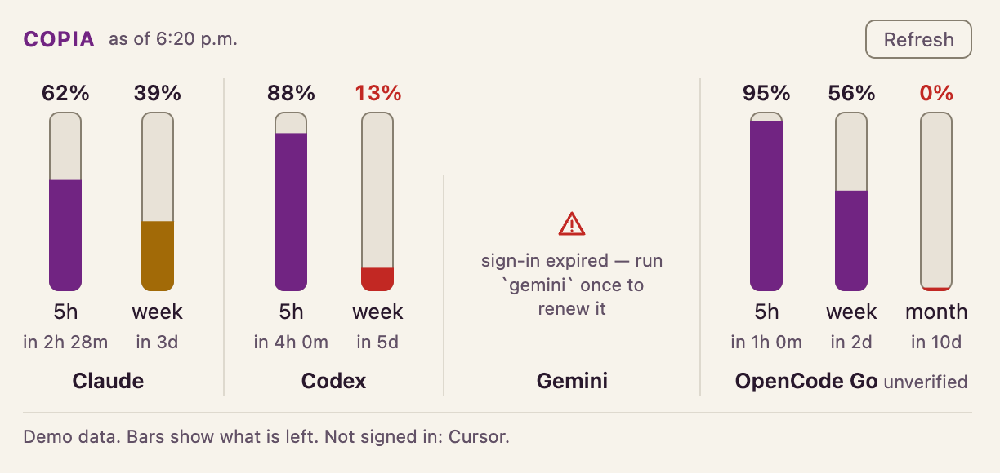

# Copia

[](https://github.com/potpiemuncher/copia/actions/workflows/build.yml)
[](https://github.com/potpiemuncher/copia/releases/latest)
[](LICENSE)

*cōpia* — Latin for plenty, supply, what you have on hand.

A small menubar / system-tray app that shows how much of your AI coding
subscriptions you have left: Claude, Codex, Antigravity and OpenCode Go. The tray
icon is itself a tiny chart, one bar per tool. Click it and you get the same
thing bigger: labelled vertical bars, one per quota window, filled to what
remains.

<picture>
  <source media="(prefers-color-scheme: dark)" srcset="docs/popover-dark.png">
  
</picture>

*The popover, shown with demo data. It follows your system's light or dark theme.*

Free, open source (MIT), no account, no telemetry. Built with
[Tauri 2](https://tauri.app).

## Install

| Your computer | Download |
| --- | --- |
| **Windows** 10 / 11 | [Copia-windows-x64-setup.exe](https://github.com/potpiemuncher/copia/releases/latest/download/Copia-windows-x64-setup.exe) |
| **macOS** 11 or later, Apple silicon or Intel | [Copia-macos-universal.dmg](https://github.com/potpiemuncher/copia/releases/latest/download/Copia-macos-universal.dmg) |
| **Linux** (Debian, Ubuntu, Mint…) | [Copia-linux-amd64.deb](https://github.com/potpiemuncher/copia/releases/latest/download/Copia-linux-amd64.deb) |
| **Linux** (anything else) | [Copia-linux-amd64.AppImage](https://github.com/potpiemuncher/copia/releases/latest/download/Copia-linux-amd64.AppImage) |

All downloads, with checksums, are on the
[releases page](https://github.com/potpiemuncher/copia/releases/latest).

The installers are **not code-signed yet**, so Windows and macOS will warn you
the first time. The steps below include how to get past that.

### Windows

1. Download **Copia-windows-x64-setup.exe** and run it.
2. If a blue "Windows protected your PC" box appears, click **More info**,
   then **Run anyway**.
3. Click through the installer.
4. Start **Copia** from the Start menu. Its icon appears in the system tray,
   by the clock; it may be tucked under the **^** arrow. Drag it onto the
   taskbar to keep it visible.

### macOS

1. Download **Copia-macos-universal.dmg** and open it.
2. Drag **Copia** onto the **Applications** folder.
3. Open Applications, **right-click Copia** and choose **Open**, then **Open**
   again in the dialog. If macOS still refuses, go to **System Settings →
   Privacy & Security**, scroll down and click **Open Anyway**. You only do
   this once.
4. Copia's bars appear in the menubar, at the top right.
5. If you use Claude Code, macOS asks whether Copia may read the
   "Claude Code-credentials" Keychain item. Choose **Always Allow**, or it
   will ask on every refresh. If you choose **Deny**, Copia stops asking
   until you press **Refresh**.

### Linux

Debian, Ubuntu and relatives:

```bash
sudo apt install ./Copia-linux-amd64.deb
```

Anything else, with the AppImage:

```bash
chmod +x Copia-linux-amd64.AppImage && ./Copia-linux-amd64.AppImage
```

Then start **Copia** from your application menu. On GNOME you need a tray
extension such as *AppIndicator and KStatusNotifierItem Support* for the icon
to show.

### First run

Copia does not sign you in to anything. It shows the tools whose own
command-line app is already signed in **on this computer**:

| To see | Be signed in with |
| --- | --- |
| Claude | [Claude Code](https://claude.com/claude-code) (`claude`) |
| Codex / ChatGPT | [Codex CLI](https://github.com/openai/codex) (`codex`) |
| Antigravity | [Antigravity CLI](https://antigravity.google/docs/cli) (`agy`) |
| OpenCode Go | [OpenCode](https://opencode.ai) (`opencode`), or set `OPENCODE_API_KEY` |

If none are signed in, the popover says so. Sign in with one, then click
**Refresh**.

### More than one Claude account

Claude Code keeps one sign-in per config folder, so to have a work and a
personal account side by side, sign the second one in to its own folder:

```bash
CLAUDE_CONFIG_DIR=~/.claude-personal claude
```

Copia finds every `~/.claude-*` (or `~/.claude_*`) folder that Claude Code has
used and shows each signed-in account as its own row, such as
**Claude (personal)**. A folder elsewhere can be added with
`claude_config_dirs` in the settings below. The same account signed in from
two folders is shown once. The Claude desktop app's own sign-in is not read:
it keeps it encrypted for itself.

### Uninstall

- **Windows:** Settings → Apps → Installed apps → Copia → Uninstall.
- **macOS:** quit Copia from its menu, then drag it from Applications to the Bin.
- **Linux:** `sudo apt remove copia`, or delete the AppImage.

Copia stores nothing except an optional settings file (see [Settings](#settings)).

## Using it

- **Left click** the tray icon: show or hide the bars. Clicking anywhere else
  hides them, as does Esc. Ctrl+R / ⌘R refreshes.
- **Right click**: Show quotas / Refresh now / Quit. On Linux, where trays only
  give apps a menu, this menu is the way in.
- **The icon**: one bar per signed-in tool, filled to what is left of that
  tool's *tightest* quota, so a nearly empty bar means "one of this tool's
  limits is close". On macOS it is a template image that follows the menubar
  colour; elsewhere bars are purple, amber below 50% and red below 20%.
- Hover the icon for the numbers as text.
- A provider marked **unverified** in the popover is one whose request or reply
  code has not been run against a live account (currently OpenCode Go).
- The popover follows the system light / dark theme, redraws its bars in
  system colours under Windows High Contrast, and exposes each bar to screen
  readers as a meter ("week: 39% left, resets in 3d").

## Status

Version 0.1.2 was released on 25 November 2026. It is early, and this section
says plainly what has and has not been checked.

**Checked**

- **macOS (Apple silicon):** installed and run. The tray icon, the popover and
  its layout work.
- **Claude, Codex and Antigravity:** fetched from live accounts. Claude
  returned its 5-hour and weekly windows; Codex returned one weekly window;
  Antigravity (`agy 1.5.16`) returned its Gemini and third-party model windows.
- **Builds:** every change is compiled and tested on macOS, Windows and Linux,
  and the installers for all three are built by CI.

**Not checked yet**

- **Windows and Linux:** nobody has reported running the installers. If you
  do, please [say how it went](https://github.com/potpiemuncher/copia/issues/new/choose).
- **macOS on Intel:** the download is a universal build, but it has only been
  run on Apple silicon.
- **OpenCode Go:** follows OpenCode's own documentation, and the endpoint
  answers as documented without a key, but it has never been run with a real
  Go key. The app marks it "unverified".

**Known problems**

- **Not code-signed.** Windows and macOS warn on first run; see
  [Install](#install).
- **macOS fullscreen:** the popover does not appear while another app is in a
  fullscreen Space. It likely needs to become an `NSPanel` (see
  `tauri-nspanel`). Outside fullscreen it shows normally.

## What it reads

Copia does not log in to anything. It reuses the sign-in each tool's own CLI
already left on your computer, asks that vendor's own usage endpoint, and shows
the answer. Credentials are read only, never written or refreshed, and each one
is sent only to the vendor it belongs to.

| Tool | Credential it reads | Asks |
| --- | --- | --- |
| Claude | macOS Keychain item `Claude Code-credentials`, else `~/.claude/.credentials.json`. Each extra config folder: item `Claude Code-credentials-<8 hex of SHA-256 of the folder>`, else `<folder>/.credentials.json` | `api.anthropic.com/api/oauth/usage` |
| Codex / ChatGPT | `~/.codex/auth.json` (or `$CODEX_HOME`) | `chatgpt.com/backend-api/wham/usage` |
| Antigravity | Runs the signed-in `agy` CLI: `$ANTIGRAVITY_CLI_PATH`, else `PATH`, else `/opt/homebrew/bin`, `/usr/local/bin` or `~/.local/bin` (Windows: `%LOCALAPPDATA%\agy\bin\agy.exe`). Runs it only if there is a sign-in: `$AGY_ADC_AUTH` or `enableAdc` in `~/.gemini/config/config.json`, else on macOS the Keychain item `gemini` / account `antigravity` (only whether it exists; its secret is not read, so this does not prompt), else (Linux, Windows, or no Keychain) `~/.gemini/antigravity-cli/cache/onboarding.json` | `agy -p /usage --output-format json` |
| OpenCode Go | `$OPENCODE_API_KEY`, else `~/.local/share/opencode/auth.json` | `opencode.ai/inference/go/v1/usage` |

Things to know:

- On macOS the first Claude fetch makes the system ask whether Copia may read
  the Keychain item (once per Claude account). Choose *Always Allow* or it asks every refresh (after a
  *Deny* it waits until you press Refresh). The
  approval is for Copia's own signed app only, so a rebuilt development binary
  asks again. (Versions before this one asked on behalf of `/usr/bin/security`,
  which let any program read the token. If you allowed that, remove `security`
  from the item's *Access Control* tab in Keychain Access.)
- None of these are documented public APIs. They are what the vendors' own
  tools call and can change without notice.
- Copia never refreshes tokens. When one ages out the bar is replaced by
  "sign-in expired — run `claude` once to renew it" (or `codex`, `agy`).
  Antigravity refreshes are run with auto-update disabled and `SSH_CONNECTION`
  set so a lapsed sign-in does not launch a browser window (with Unix
  `open`/`xdg-open` stubs as a backstop; Windows has not been live-tested).
  Copia stops `agy` as soon as it asks for a sign-in rather than letting it
  wait for a code.
- OpenCode Go is the one provider with a vendor-documented usage endpoint, and
  Copia follows that documentation, but it has not been run with a real Go
  key. OpenCode v2 keeps credentials in a SQLite database Copia does not read,
  so if `auth.json` is missing or stale, set `OPENCODE_API_KEY` to your Go key.
- **Not built yet:** OpenCode Zen balance, Cursor, Copilot. Use a
  custom command (below) or send a patch to `src/providers.rs`; a provider is
  one function.

A tool you are not signed in to is simply left out.

## Settings

Optional. `config.json` in `~/Library/Application Support/copia/` (macOS),
`~/.config/copia/` (Linux) or `%APPDATA%\copia\` (Windows). It is re-read on
every refresh. If it cannot be read or is not valid JSON, Copia uses the
defaults and shows the reason under **Settings** in the popover.

```json
{
  "refresh_minutes": 5,
  "disabled": ["antigravity"],
  "claude_config_dirs": ["/Volumes/Work/claude-config"],
  "custom": [
    { "name": "My tool", "command": ["/path/to/script"] }
  ]
}
```

Provider ids for `disabled`: `claude`, `codex`, `antigravity`, `opencode-go`, and
`claude:<name>` for an extra Claude folder (`claude:personal` for
`~/.claude-personal`).

`claude_config_dirs` lists extra Claude Code config folders that are not
`~/.claude-*`. Write each one exactly as you set `CLAUDE_CONFIG_DIR`, since
Claude Code names its Keychain item after that text.

A **custom** provider is any program that prints quotas as JSON, with `used` or
`remaining` as a fraction from 0 to 1 and `resets_at` as epoch seconds or an
ISO-8601 time:

```json
[
  { "label": "day", "remaining": 0.4, "resets_at": "2026-11-23T00:00:00Z" },
  { "label": "month", "used": 0.15 }
]
```

A custom command gets 15 seconds and 1 MB of output; past either it is stopped
and its bar shows why. Because these commands run on every refresh, on macOS
and Linux Copia runs them only when `config.json` and its folder belong to you
and cannot be written by group or others (`chmod go-w`); otherwise it skips
them and says so in the popover.

## Build from source

You need [Rust](https://rustup.rs). On Linux also the Tauri system libraries:

```bash
sudo apt install libwebkit2gtk-4.1-dev libayatana-appindicator3-dev librsvg2-dev libxdo-dev
```

Then:

```bash
cargo run --release
```

To look at it with made-up numbers and without touching any credential:

```bash
cargo run --release -- --demo
```

To check what Copia can read without opening the tray, print the quotas once
as JSON (no tokens are printed):

```bash
cargo run --release -- --print
```

An installed copy takes the same flag. On Windows, run it from the folder
Copia is installed in (the installer does not add it to `PATH`); the prompt
can come back before the output appears, so use `start /wait Copia.exe --print`
in cmd or `.\Copia.exe --print | Out-Host` in PowerShell to wait for it.

To make an installable app (`.app`/`.dmg`, `.msi`, `.deb`/`.AppImage`):

```bash
cargo install tauri-cli --version "^2" --locked
```

```bash
cargo tauri build
```

## Getting help

- Something broken, or a number looks wrong:
  [open an issue](https://github.com/potpiemuncher/copia/issues/new/choose).
- Anything else: **support@pulsarit.ca**.
- Security problems: see [SECURITY.md](SECURITY.md).

## Layout

```
src/main.rs        tray icon, popover window, refresh loop
src/providers.rs   one function per tool: read credential, fetch, map to quotas
src/icon.rs        draws the tray icon's bars
ui/index.html      the popover (plain HTML, CSS and JS, no build step)
ui/style.css       its styles
ui/app.js          its script (kept out of the HTML for the strict CSP)
ui/preview.js      demo stand-in so index.html can be opened in a browser
scripts/make_icons.py   regenerates icons/
```

## Credits

- The idea came from [@zip.mu.social](https://rainshare.dev/seed/zip.mu.social/3n2v6joikno2l)
  on Rainshare: <https://rainshare.dev/seed/zip.mu.social/3n2v6joikno2l>.
- The work was done by Claude Fable 5.2 (`claude-fable-5-2`) in Claude Code.
- Which endpoint each vendor's CLI calls was learned from the provider notes in
  [CodexBar](https://github.com/steipete/CodexBar) (MIT), a far more complete
  macOS app. If you are on a Mac and want 50+ providers today, use that.
  [Win-CodexBar](https://github.com/nesszer/Win-CodexBar) and
  [AI Usage Widget](https://odrasile.github.io/ai-usage-widget/) are also worth
  a look.

## License

[MIT](LICENSE)
